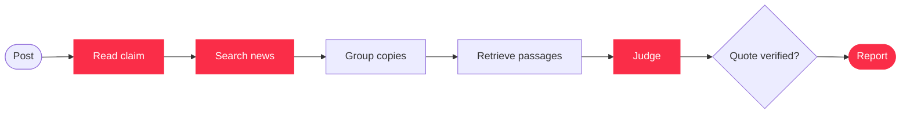

# newscheck

**See what the news actually says.**
Paste a viral post. newscheck reads the claim, searches recent news coverage, and shows you which independent sources agree, which disagree, and the exact sentence each one said.

[Live demo](https://newscheck-ed7r.onrender.com) · [How it works](#how-a-check-works) · [Run it locally](#quick-start) · [Use it from Claude](#use-it-from-claude-or-any-mcp-client)

---

## Why newscheck exists

"BREAKING: Microsoft is kicking out 60,000 employees!!! Share before it gets deleted."

Posts like this spread faster than any fact-check can. By the time a debunk is written, the post has been shared thousands of times. Most fact-checking tools answer with a label, *true* or *false*, and ask you to trust it.

newscheck doesn't hand out labels. It does what a careful reader would do if they had ten minutes and ten browser tabs: find the coverage, set aside the outlets that copied each other, read each article, and quote what it says. In about a minute you can see that three independent outlets describe the same event as *voluntary buyouts*, not *kicking out*, and judge the post for yourself.

A tool that issues verdicts has to be right every time. A tool that shows its sources only has to quote them accurately, and accurate quoting is something code can check.

## Three ideas

**Evidence, not verdicts.** There is no truth score, no "fake" stamp, and no verdict. Every report ends with: *newscheck shows what news articles say. It does not decide whether a claim is true.*

**Independent sources only.** One wire story republished by forty sites is one source, not forty. newscheck detects syndicated copies and counts each story once, so a claim can't look well-supported just because it was copy-pasted widely.

**Every quote is real.** Before a quote reaches you, code checks that it appears word for word in the article. If the model paraphrases, it gets one retry; after that, the source is reported as "doesn't address this claim" rather than shown with an invented quote.

## What you get

```
CLAIM CHECKED: Microsoft is laying off 60,000 employees.

2 independent source(s) report something different from the post.

- Microsoft offers voluntary buyouts to staff  (disagrees with the post)
    "…offered voluntary buyouts to eligible employees…"
    Reports instead: voluntary buyouts, not layoffs
    https://…
    Also published by (same text): 3 other sites

- …  (doesn't address this claim)

newscheck shows what news articles say. It does not decide whether a claim is true.
```

*(Illustrative layout. Real reports link to every article.)*

On the web app, progress streams live as the check runs: reading the post, searching, grouping sources, reading articles, comparing. Then a short summary is written word by word and the full report appears as source cards.

## How a check works



<sub>Red steps call the model (Groq). Every other step is plain code.</sub>

The model makes judgment calls. The rules are enforced in code:

- **Stance is computed, not guessed.** The model checks each detail of the claim, and code turns those checks into *agrees*, *disagrees*, or *doesn't address*.
- **Nothing relevant means no model call.** If no passage clears the relevance floor, that source isn't sent to the model at all.
- **The agent has limits.** The search agent chooses its own queries, but code caps the number of searches, always adds a fact-check search, and leaves the claim read-only.
- **Copies are detected lexically.** Articles are compared by overlapping 5-word phrases, not embeddings, because independent reports of the same event are semantically near-identical.

## Measured, not assumed

Each design choice came from an experiment on frozen data:

| Decision | Result |
|---|---|
| Sentence-aware chunking | hit@2 of **0.79** across 29 cases (semantic chunking: 0.72 at best; fixed-size: 0.55) |
| Hybrid retrieval (dense + BM25) | hit@1 up from **0.55 to 0.66** |
| Relevance floor of 0.55 | keeps **100%** of answerable sources and silences **75%** of irrelevant ones |
| Per-detail judging | the "kicking out vs. voluntary buyouts" case went from 2 wrong *agrees* to 0–1 |

The test suite runs offline in seconds, with the model, search, and embeddings replaced by fakes, so it never spends a credit.

## Quick start

```bash
uv sync
```

Add a `.env` file in the project root:

```
GROQ_API_KEY=your-groq-key
TAVILY_API_KEY=your-tavily-key
```

Start the web app and API together, then open http://127.0.0.1:8000:

```bash
uv run uvicorn web.server:app
```

Or call the API directly. It streams progress as Server-Sent Events and ends with a `done` event that carries the report:

```bash
curl -N -X POST http://127.0.0.1:8000/api/check \
  -H "Content-Type: application/json" \
  -d '{"text": "BREAKING: Microsoft is kicking out 60,000 employees!!!"}'
```

Each check spends real Tavily credits and Groq tokens.

### Use it from Claude or any MCP client

newscheck also runs as an MCP server with one tool, `check_claim(text)`:

```bash
uv run newscheck-mcp
```

Register it in `claude_desktop_config.json`:

```json
{ "mcpServers": { "newscheck": {
    "command": "uv",
    "args": ["run", "--directory", "/absolute/path/to/newscheck", "python", "-m", "newscheck.mcp_server"]
} } }
```

### Tests and evals

```bash
uv run pytest                          # offline, a few seconds
uv run python eval/retrieval_eval.py   # chunking and retrieval comparison, no API calls
uv run python eval/agent_eval.py       # live: search agent vs single search, spends credits
```

## Built with

| Layer | Tools |
|---|---|
| Models | Groq (`openai/gpt-oss-20b`), structured outputs, tool calling |
| Search | Tavily (news mode, one-month window, social media excluded) |
| Retrieval | fastembed (`bge-small-en-v1.5`), Qdrant in memory, BM25, reciprocal rank fusion |
| Serving | FastAPI, Server-Sent Events, MCP Python SDK, Docker |
| Quality | pytest, ruff, frozen-data evals |

## Honest limitations

- English only. Hinglish is translated silently and can pick up details along the way.
- Two separate facts in one post are checked as a single claim.
- The streamed summary is free text and can overstate agreement. The report below it is the source of truth.
- Live search results drift between runs, and thresholds are calibrated on small evals.
- The live demo runs on a free instance. It sleeps when idle, and a check can take several minutes.

## How it was built

v1 was built quickly with an AI agent. v2, this repository, was rebuilt from scratch one decision at a time, with one pull request per feature. The `experiments/` folder is the trail: each script tested a single idea (structured outputs, copy detection, chunking, embeddings, per-source retrieval, streaming, the search agent) before it became part of `src/newscheck/`.
